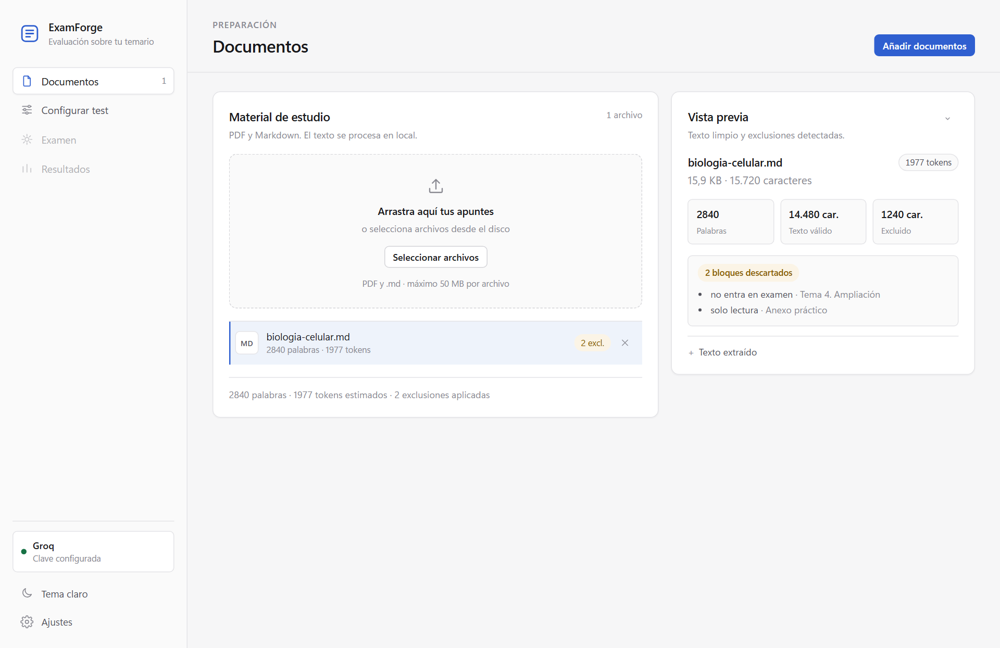
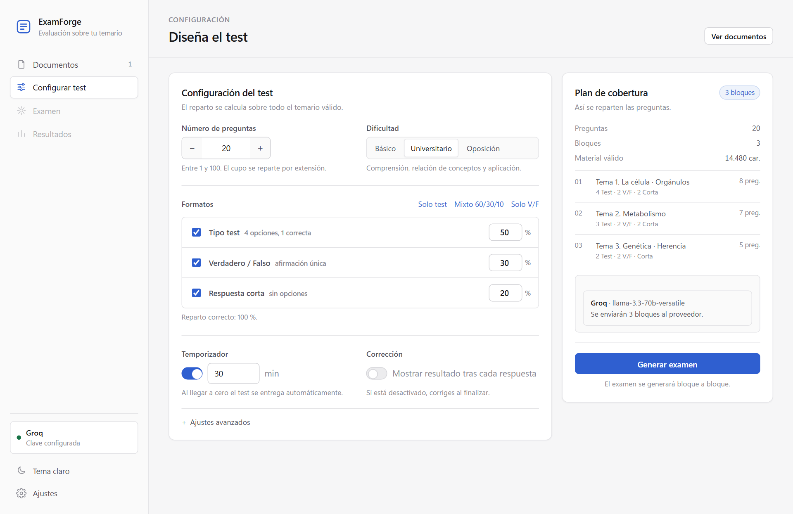
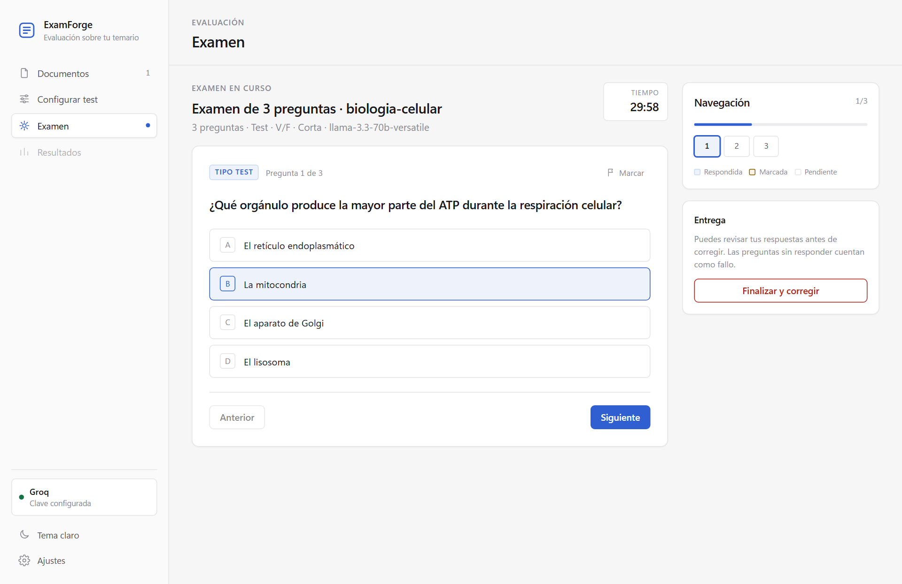
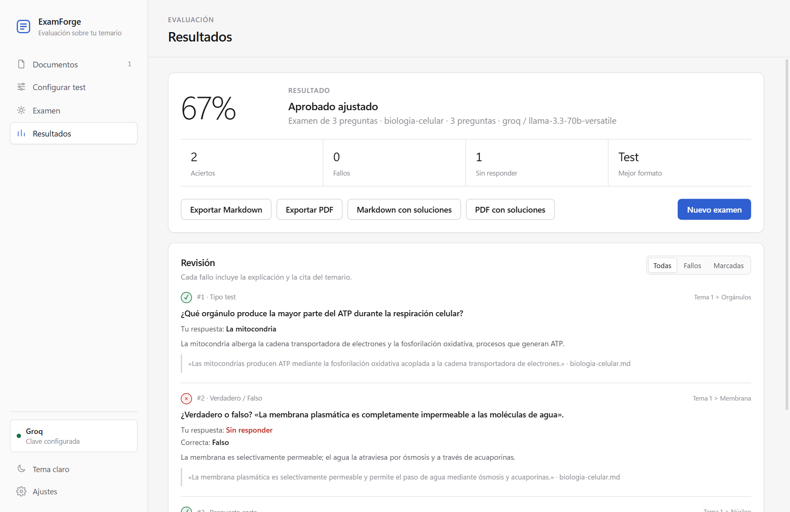
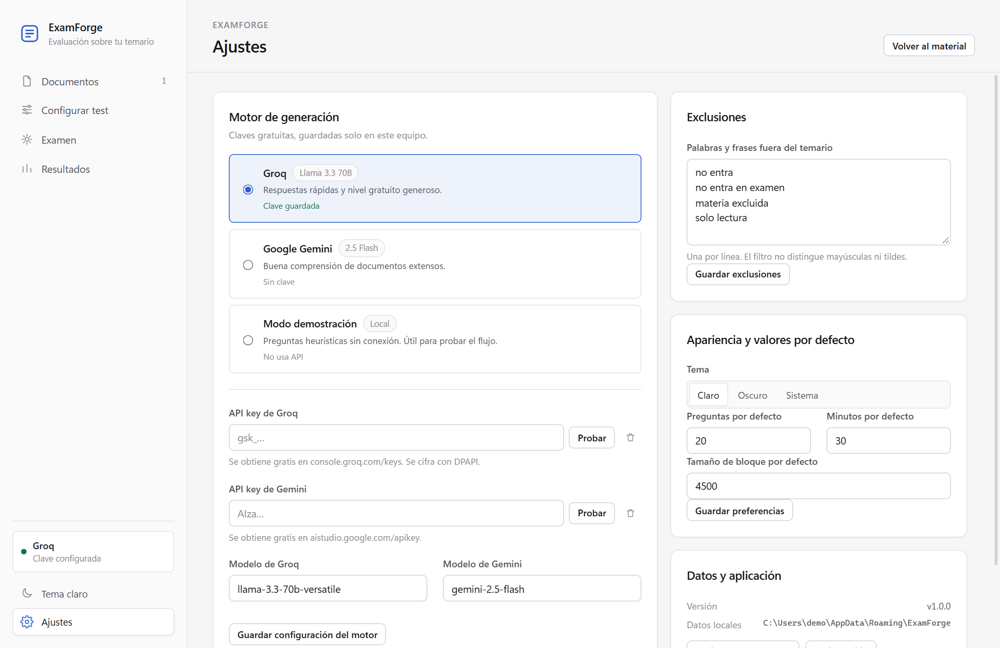
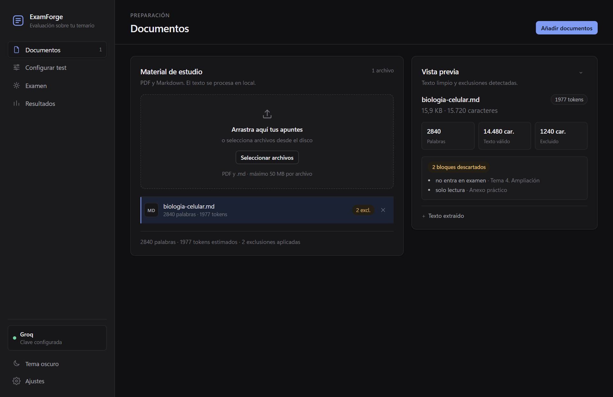
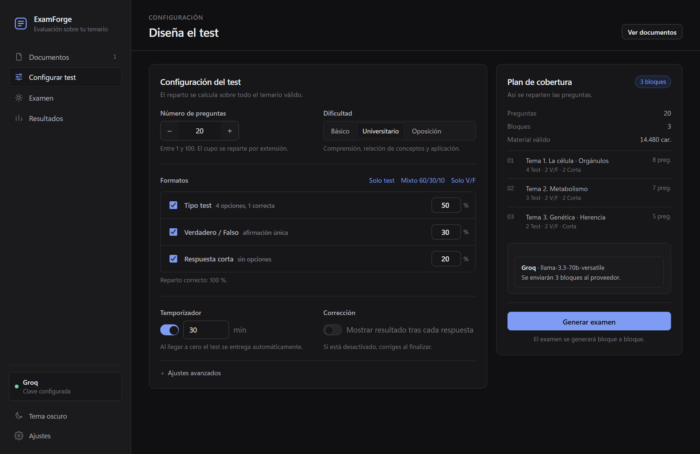

# ExamForge

Aplicación de escritorio para convertir apuntes en **PDF o Markdown** en exámenes interactivos, con cobertura repartida por todo el temario, filtros de exclusión y corrección comentada que cita el material original.

Python + PyWebView, interfaz en HTML/CSS/JS sin frameworks y empaquetado en un único `ExamForge.exe` para Windows. La generación usa los niveles gratuitos de **Groq** (Llama 3.3 70B) o **Google Gemini** (2.5 Flash), y también incluye un **modo demostración** sin clave ni conexión.



## Índice

- [Inicio rápido con el .exe](#inicio-rápido-con-el-exe)
- [Qué hace](#qué-hace)
- [Capturas](#capturas)
- [Claves de API gratuitas](#claves-de-api-gratuitas)
- [Cómo funciona](#cómo-funciona)
- [Arquitectura](#arquitectura)
- [Desarrollo](#desarrollo)
- [Compilar el ejecutable](#compilar-el-ejecutable)
- [Tests](#tests)
- [Privacidad y seguridad](#privacidad-y-seguridad)
- [Errores y límites de los proveedores](#errores-y-límites-de-los-proveedores)
- [Limitaciones conocidas](#limitaciones-conocidas)
- [Flujo de Git](#flujo-de-git)
- [Publicar en GitHub](#publicar-en-github)

## Inicio rápido con el .exe

1. Descarga o compila `dist/ExamForge.exe`.
2. Ejecútalo. No necesita Python instalado ni instalador; en Windows 10/11 se apoya en WebView2, que viene preinstalado.
3. Arrastra tus apuntes de **PDF o Markdown** al panel de documentos (o usa «Seleccionar archivos»).
4. Revisa la vista previa: texto extraído, palabras, tokens estimados y bloques descartados.
5. En **Ajustes**, pega una clave gratuita de Groq o Gemini y pulsa «Probar». También puedes elegir **Modo demostración** para probar el flujo completo sin clave.
6. En **Configurar test** elige número de preguntas, formatos, dificultad y temporizador.
7. Pulsa **Generar examen**, responde y corrige. Desde Resultados puedes exportar a Markdown o PDF, con o sin soluciones.

> El ejecutable no modifica el registro ni instala servicios. La configuración y las claves se guardan en `%APPDATA%\ExamForge`.

## Qué hace

- **Ingesta múltiple**: arrastrar y soltar o selector de archivos; PDF y `.md`/`.markdown`, hasta 50 MB por archivo y 30 documentos por sesión.
- **Vista previa honesta**: texto limpio, páginas, palabras, tokens estimados, porcentaje de material excluido y motivo de cada exclusión.
- **Exclusiones configurables**: detecta títulos y párrafos marcados como «no entra», «no entra en examen», «materia excluida», «solo lectura», «no evaluable», etc. La lista de frases se edita en Ajustes.
- **Cobertura global**: el material válido se divide en bloques y el número exacto de preguntas se reparte de forma proporcional. La interfaz muestra el plan antes de llamar al modelo.
- **Formatos mixtos**: tipo test de 4 opciones, verdadero/falso y respuesta corta, con porcentajes normalizados a 100.
- **Dificultad**: básica (recuerdo), universitaria (comprensión y aplicación) u oposición (matices y distractores cercanos).
- **Examen interactivo**: navegación por preguntas, marcado para revisar, progreso, temporizador opcional y entrega automática al agotarse el tiempo.
- **Corrección y explicación**: cada pregunta lleva explicación y una cita literal del temario, validada contra el texto de origen. La revisión permite filtrar por fallos o marcadas.
- **Exportación**: Markdown y PDF, tanto del examen limpio como de la versión con soluciones y referencias.
- **Temas reales**: claro, oscuro y sistema, sin depender de frameworks ni CDN.

## Capturas

| Documentos y exclusiones | Configuración y cobertura |
| --- | --- |
|  |  |

| Examen | Resultados y revisión |
| --- | --- |
|  |  |

| Ajustes y proveedores | Documentos en tema oscuro |
| --- | --- |
|  |  |

Configuración con el tema oscuro activo:



Las capturas usan material de demostración y el puente simulado del modo de revisión de interfaz; no contienen claves ni apuntes reales.

## Claves de API gratuitas

ExamForge no incluye claves. Solo se envía al proveedor el fragmento de temario necesario para cada bloque, nunca los archivos completos ni rutas locales.

### Groq (recomendado)

1. Entra en [console.groq.com/keys](https://console.groq.com/keys) y crea una cuenta gratuita.
2. Pulsa **Create API Key**, ponle un nombre y copia la clave `gsk_...` (solo se muestra una vez).
3. En ExamForge abre **Ajustes → API key de Groq**, pégala y pulsa **Probar**.
4. Guarda la configuración. El modelo por defecto es `llama-3.3-70b-versatile`.

### Google Gemini

1. Entra en [aistudio.google.com/apikey](https://aistudio.google.com/apikey) con una cuenta de Google.
2. Crea una clave en un proyecto y copia el valor `AIza...`.
3. En **Ajustes → API key de Gemini**, pégala, prueba la conexión y guarda.
4. El modelo por defecto es `gemini-2.5-flash`.

### Alternativas

- **Modo demostración**: genera preguntas heurísticas en local. Sirve para validar la interfaz y el flujo, pero no sustituye a un modelo real.
- **Variables de entorno**: `GROQ_API_KEY` y `GEMINI_API_KEY` tienen prioridad sobre la clave guardada, útil para desarrollo y CI.

### Dónde se guardan

- Preferencias no sensibles: `%APPDATA%\ExamForge\settings.json`.
- Claves: `%APPDATA%\ExamForge\secrets.json`, cifradas con **DPAPI** (`CryptProtectData`) y ligadas al usuario de Windows actual.
- Fuera de Windows existe un modo base64 marcado explícitamente como no seguro; el ejecutable distribuido es Windows-only.

## Cómo funciona

```text
PDF / Markdown
      │
      ▼
extracción tolerante ──► limpieza (ligaduras, tablas, Markdown)
      │
      ▼
filtro de exclusiones ──► bloques descartados + motivos
      │
      ▼
planificación de bloques ──► reparto exacto de preguntas
      │
      ▼
prompt por bloque ──► Groq / Gemini / demo
      │
      ▼
JSON estricto + Pydantic ──► reparación y reintento si falla
      │
      ▼
verificación de citas ──► examen interactivo ──► exportación
```

1. **Extracción**: PyMuPDF para PDF (incluida reconstrucción de tablas y detección de PDF cifrados o sin capa de texto) y un limpiador específico para Markdown.
2. **Exclusiones**: se aplican por sección y por párrafo; el filtro no distingue mayúsculas ni tildes y conserva la trazabilidad del motivo.
3. **Reparto**: cada bloque recibe un número entero de preguntas proporcional a su extensión válida, con ajuste para que el total coincida exactamente con el solicitado.
4. **Generación**: cada bloque se envía por separado con el formato y la dificultad elegidos. El modelo debe devolver JSON válido; si no, se intenta una reparación y un único reintento.
5. **Validación**: Pydantic comprueba forma, número de opciones, índices correctos y unicidad. Las citas deben aparecer literalmente en el bloque de origen; las que no se pueden verificar se rechazan.
6. **Entrega**: el examen se mantiene en memoria durante la sesión. Las respuestas se corrigen con comparación tolerante para respuesta corta (tildes, mayúsculas y erratas leves).

## Arquitectura

```text
┌────────────────────────────────────────────────────────────┐
│ PyWebView (ventana nativa, WebView2)                       │
│  examforge/ui: index.html · styles.css · app.js             │
└───────────────▲────────────────────────────────────────────┘
                │ window.pywebview.api (JSON)
┌───────────────┴────────────────────────────────────────────┐
│ examforge/api.py — puente y validación de argumentos       │
│  envelopes {ok, data | error} · sesión de documentos       │
└───────▲──────────────▲──────────────▲──────────────────────┘
        │              │              │
┌───────┴──────┐ ┌─────┴──────┐ ┌─────┴──────────┐
│ parser/      │ │ ai/        │ │ export/        │
│ extract      │ │ generator  │ │ markdown       │
│ exclusions   │ │ providers  │ │ pdf            │
│ chunking     │ │ demo       │ │                │
└───────▲──────┘ └─────▲──────┘ └─────▲──────────┘
        │              │              │
┌───────┴──────────────┴──────────────┴──────────────────────┐
│ models.py · config.py · errors.py (contratos compartidos)  │
│ Pydantic · DPAPI · preferencias locales                    │
└────────────────────────────────────────────────────────────┘
```

### Estructura del proyecto

```text
examforge_test/
├── examforge/
│   ├── __main__.py          # entrada del ejecutable
│   ├── app.py               # ventana PyWebView, logs y drop-zone
│   ├── api.py               # puente JS ↔ Python y sesión
│   ├── models.py            # contratos Pydantic
│   ├── config.py            # preferencias + DPAPI
│   ├── errors.py            # errores de dominio
│   ├── parser/
│   │   ├── extract.py       # PDF/Markdown → texto limpio
│   │   ├── exclusions.py    # filtro de material fuera de temario
│   │   └── chunking.py      # reparto proporcional de preguntas
│   ├── ai/
│   │   ├── providers.py     # clientes Groq y Gemini con reintentos
│   │   ├── prompts.py       # prompts y contrato JSON
│   │   ├── generator.py     # generación por bloque + validación
│   │   └── demo.py          # generador local sin API
│   ├── export/
│   │   ├── markdown.py
│   │   └── pdf.py
│   └── ui/                  # HTML, CSS y JS sin frameworks
├── tests/                   # parser, IA y API
├── docs/                    # capturas e icono de documentación
├── resources/               # icono y metadatos de versión
├── examforge.spec           # receta PyInstaller
├── build.py / build.bat     # empaquetado reproducible
└── requirements*.txt
```

## Desarrollo

Requisitos: **Windows 10/11 x64**, **Python 3.11+** (probado con 3.12) y WebView2 (incluido en Windows actuales).

```powershell
git clone https://github.com/afc00073-lab/test.git
cd test
py -3.12 -m venv .venv
.venv\Scripts\Activate.ps1
python -m pip install -r requirements-dev.txt
python -m examforge
```

Para trabajar solo con la interfaz puedes servir `examforge/ui` con cualquier servidor estático, pero las llamadas al puente necesitan PyWebView o un mock local.

## Compilar el ejecutable

```powershell
python build.py            # tests + limpieza + PyInstaller
python build.py --skip-tests
```

En Windows también puedes ejecutar `build.bat`. El resultado es un único archivo:

```text
dist\ExamForge.exe
```

`build.py` comprueba la versión de Python y las dependencias, ejecuta la suite (salvo `--skip-tests`), limpia `build/` y `dist/`, invoca `examforge.spec` y muestra ruta, tamaño y SHA-256 del artefacto. El `.spec` incluye la UI, los binarios de PyMuPDF, los backends de PyWebView y los metadatos de versión; la consola está desactivada.

## Tests

```powershell
python -m pytest -q
```

Cobertura actual: extracción de PDF/Markdown, reconstrucción de tablas, filtros de exclusión, reparto exacto de preguntas, extracción de JSON, verificación de citas, mapeo de errores de proveedor, modo demostración, exportadores y contrato del puente.

## Privacidad y seguridad

- El texto se procesa **en local**. Solo se envían al proveedor los bloques necesarios para generar preguntas.
- No hay telemetría, cuentas propias ni servidor intermedio.
- Las claves se cifran con DPAPI y nunca se devuelven al frontend: la interfaz solo recibe indicadores `*_key_set`.
- Los archivos originales no se copian ni se modifican. La sesión de documentos vive en memoria.
- Los errores del puente se devuelven con un sobre estable y sin trazas internas en la interfaz.

## Errores y límites de los proveedores

- **Sin clave o clave inválida**: mensaje accionable y acceso directo a Ajustes.
- **Timeout**: 15 s de conexión y 120 s de lectura; hasta 3 intentos con espera creciente.
- **Límite de peticiones (429)**: se respeta `Retry-After` cuando está disponible y se informa del bloque afectado.
- **JSON inválido o recuento incorrecto**: una reparación y un reintento; si persiste, se muestra el error sin romper el examen ya generado.
- **PDF cifrado, corrupto o escaneado**: se detecta antes de generar y se explica que hace falta una versión con texto seleccionable (no hay OCR).
- **Cancelación de exportación**: el diálogo nativo puede cancelarse sin dejar archivos a medias.

## Limitaciones conocidas

- Los PDF escaneados sin capa de texto no se pueden leer; no se incluye OCR.
- El nivel gratuito de Groq/Gemini tiene cuotas y puede variar con el tiempo.
- La calidad de las preguntas depende del material: apuntes desordenados producen exámenes peores.
- La respuesta corta se corrige con tolerancia a tildes y erratas leves, no con un modelo juez.
- La exportación PDF usa fuentes base14 (Helvetica); glifos poco habituales o emoji pueden no representarse.
- El empaquetado está pensado para Windows x64. El código de UI y núcleo es multiplataforma, pero DPAPI y el `.exe` son específicos de Windows.

## Flujo de Git

El repositorio conserva el historial de tres líneas de trabajo paralelas, integradas con merges `--no-ff`:

| Rama | Responsabilidad | Autor simulado |
| --- | --- | --- |
| `feature/document-parser` | Extracción, exclusiones, chunking y tests | Carlos M. |
| `feature/ai-engine` | Proveedores, prompts, validación y demo | Elena R. |
| `feature/desktop-ui` | Shell, diseño, examen y ajustes | Sofía G. |
| `develop` | Integración y puente API | — |
| `main` | Versión estable etiquetada | — |

Cada rama usa commits atómicos con Conventional Commits (`feat`, `fix`, `test`, `chore`). `main` contiene la release `v1.0.0`.

## Publicar en GitHub

El remoto ya está configurado como `origin` (`https://github.com/afc00073-lab/test.git`). Desde una copia con credenciales:

```powershell
git push -u origin main
git push origin develop
git push origin --tags
```

No se ha reescrito el historial ni se ha hecho `force-push`. Si el remoto rechaza `main` por contener el README inicial, integra ese commit con un merge normal antes de subir; no fuerces la rama.
